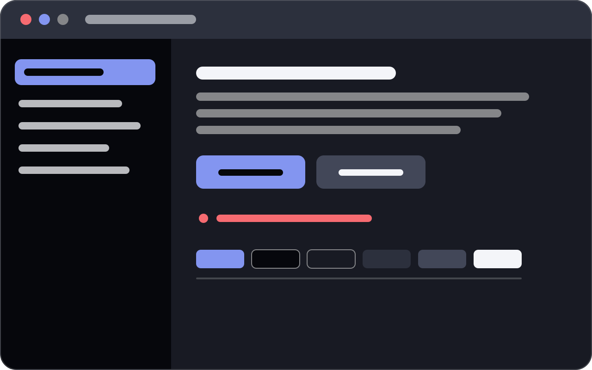

# Wallpaper Style

A cohesive desktop appearance derived from your wallpaper, for **KDE Plasma 6 on
Wayland**. It reads the current image wallpaper, extracts a contrast-checked
palette, and applies a matching Plasma colour scheme, an optional Kvantum theme
for Qt applications, and optional scoped per-application window transparency.

Everything runs locally. No wallpaper, window title or colour is ever sent
anywhere.



## What it does

| Feature | Status on Plasma 6 / Wayland |
|---|---|
| Detect the active image wallpaper | Works, with a config-file fallback |
| Watch for wallpaper changes | Works (polling; see [limitations](docs/LIMITATIONS.md)) |
| Extract an accent and full palette | Works, native Rust decoding and OKLab maths |
| Dark and light variants with contrast checks | Works; every palette is verified at 4.5:1 |
| Plasma colour scheme | Works |
| Kvantum theme (controls and menus) | Works when Kvantum has a base theme selected |
| Background-only transparency | Qt applications only; see limitations |
| Per-app window opacity (KWin effect) | Works; scoped to the current desktop and activity |
| Preview, apply, restore, uninstall | Works; every apply is snapshotted first |
| CLI and GUI | Both, sharing the same core |

## Install

### Arch Linux and derivatives

```bash
cd packaging/arch
makepkg -si
```

The package installs the binaries, desktop entry and icon, and prints what to run
next. **It does not modify your desktop.** That is deliberate: a package
post-install step cannot know which user's desktop to change.

### Any distribution, from source

```bash
cargo build --release
sudo install -Dm755 target/release/wallpaper-style /usr/local/bin/wallpaper-style
sudo install -Dm755 target/release/wallpaper-style-gui /usr/local/bin/wallpaper-style-gui
sudo install -Dm644 assets/io.github.wallpaperstyle.desktop \
    /usr/local/share/applications/io.github.wallpaperstyle.desktop
sudo install -Dm644 assets/io.github.wallpaperstyle.svg \
    /usr/local/share/icons/hicolor/scalable/apps/io.github.wallpaperstyle.svg
```

A Flatpak or Snap is **not** offered. Those sandboxes cannot load a KWin effect
into the host compositor or rewrite the host's KDE configuration, which is the
core of what this application does. Offering one would mean advertising features
that silently do nothing. See [docs/LIMITATIONS.md](docs/LIMITATIONS.md).

### Requirements

Required: `kwin`, `plasma-workspace`, `qt6-tools` (for `qdbus6`), `kconfig`
(for `kwriteconfig6`/`kreadconfig6`), a Wayland session, and systemd user
services.

Optional, detected and reported: `kvantum` for Qt application theming,
`xdg-desktop-portal` for the native image chooser.

Run `wallpaper-style doctor` to check your machine.

## Use it

```bash
wallpaper-style doctor      # what is installed, what works here
wallpaper-style status      # what it is doing now
wallpaper-style preview     # palette and what applying would change — writes nothing
wallpaper-style install     # background service + KWin effect (idempotent)
wallpaper-style apply       # snapshot, then apply
```

Then open **Wallpaper Style** from your application launcher for the graphical
control centre, which covers the same ground with a live preview.

Turn on **Update automatically** in the Theme page (or `wallpaper-style settings
--set general.automatic=true`) to re-theme whenever the wallpaper changes.

### Transparency

Per-app opacity is off by default. Enable it on the Transparency page, pick the
applications you want, and press **Apply transparency**. Presets cover Codex,
Claude, VS Code, Cursor, browsers, Garuda Toolbox, Steam, Heroic and the
VirtualBox Manager.

The effect never touches panels, notifications, tooltips, or VirtualBox guest
windows, and never moves a window between virtual desktops or activities.

### Undo

```bash
wallpaper-style snapshot list     # what can be restored
wallpaper-style restore           # revert the most recent apply
wallpaper-style uninstall         # revert everything and remove the service
```

Restore compares the current state with what was applied. Anything you changed
in the meantime is **left alone** and reported as a conflict; `--force`
overwrites it.

## How it works

```
 crates/ws-palette    image → palette            no desktop knowledge
 crates/ws-core       settings, policy, snapshots  no desktop knowledge
 crates/ws-backend    trait definitions          swappable per desktop
 crates/ws-plasma     KDE Plasma 6 / KWin / Kvantum
 crates/ws-service    the background watcher
 crates/ws-cli        wallpaper-style
 crates/ws-gui        wallpaper-style-gui
```

The palette crate is pure: it takes an image and returns colours with contrast
measurements. The core crate owns settings, migration, the preset catalogue and
the snapshot model, and knows nothing about KDE. All KDE-specific behaviour lives
behind the traits in `ws-backend`, so another desktop can be added without
touching the domain logic, the CLI or the GUI.

See [docs/ARCHITECTURE.md](docs/ARCHITECTURE.md) for the reasoning behind the
design and the library choices, and [docs/TESTING.md](docs/TESTING.md) for what
was actually verified and which bugs that turned up.

## Privacy

The service reads your wallpaper file, your Plasma/KWin/Kvantum configuration,
and the list of open window classes (only when you use the Identify tool). It
writes logs that never include window titles or wallpaper paths, and it makes no
network requests.

## Limitations

The honest list is in [docs/LIMITATIONS.md](docs/LIMITATIONS.md). The
significant ones:

* Wayland-only for first-class support; X11 works through Plasma's compositor but
  is untested.
* Per-app transparency uses Plasma's compositor script API. It cannot work on
  GNOME, wlroots compositors or via XDG portals.
* Background-only transparency depends on the application using Kvantum; Electron
  apps and browsers get whole-window opacity instead.
* Wallpaper changes are detected by polling, not by an inotify watch on the
  configuration file.
* Slideshow wallpapers are followed only when the plugin publishes its current
  frame.

## Trying it without changing your desktop

Everything the application writes is derived from the XDG base directories, so
you can exercise the whole workflow in a throwaway tree:

```bash
export XDG_CONFIG_HOME=$PWD/.try/config XDG_DATA_HOME=$PWD/.try/data \
       XDG_STATE_HOME=$PWD/.try/state XDG_CACHE_HOME=$PWD/.try/cache
target/release/wallpaper-style install --no-enable
target/release/wallpaper-style preview --image ~/Pictures/wallpaper.jpg
target/release/wallpaper-style apply   --image ~/Pictures/wallpaper.jpg
target/release/wallpaper-style restore
rm -rf .try
```

`apply` will still ask Plasma to activate the generated colour scheme, so use
`preview` if you only want to look. `install --no-enable` does not start or
enable the service.

## Licence

MIT. See [LICENSE](LICENSE).
